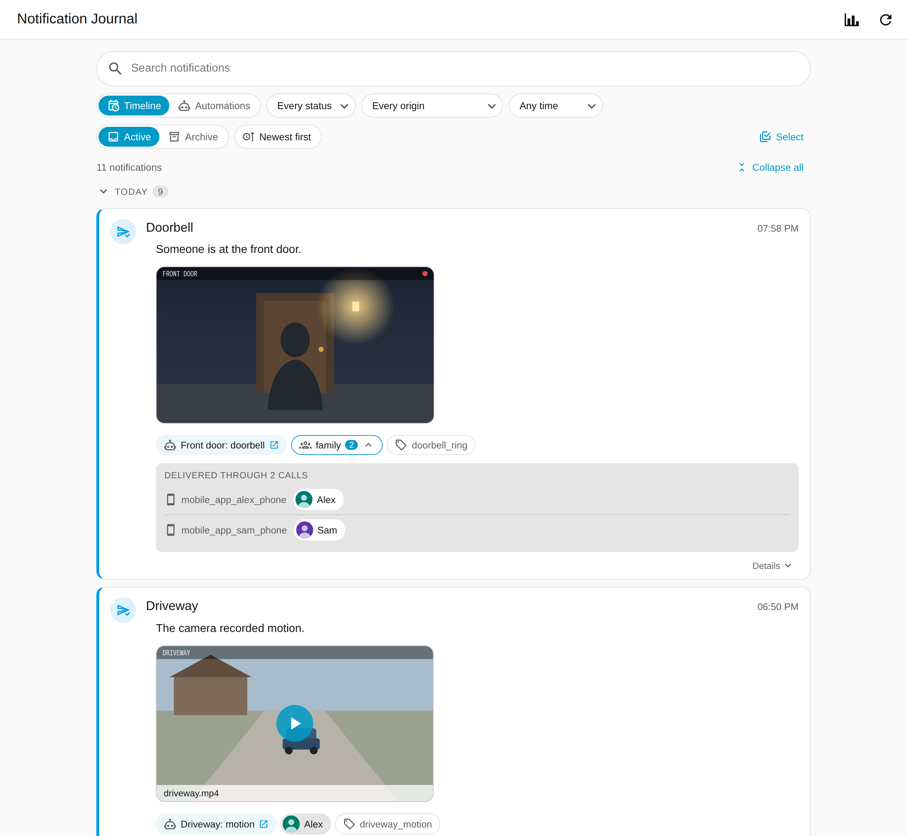
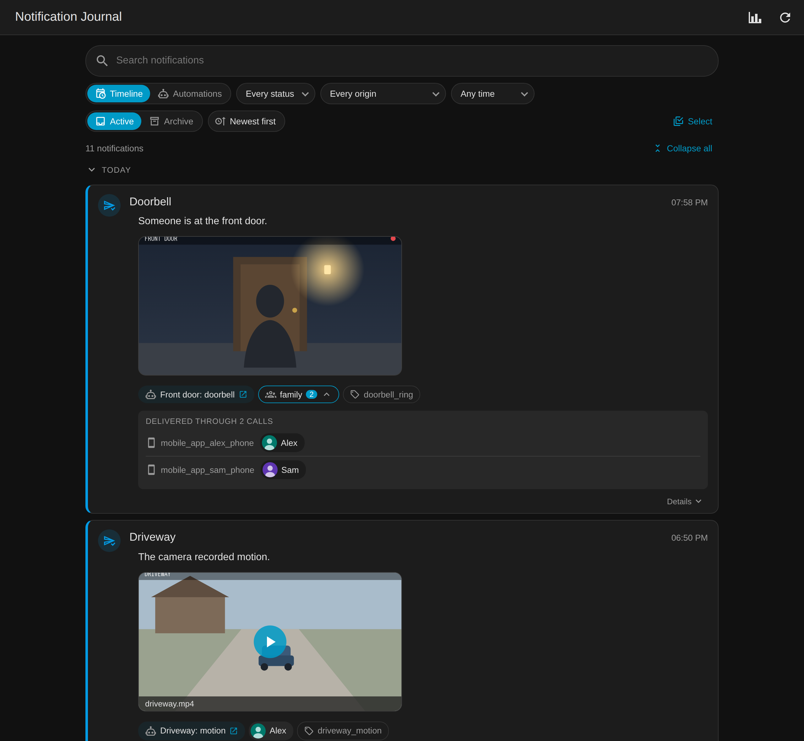
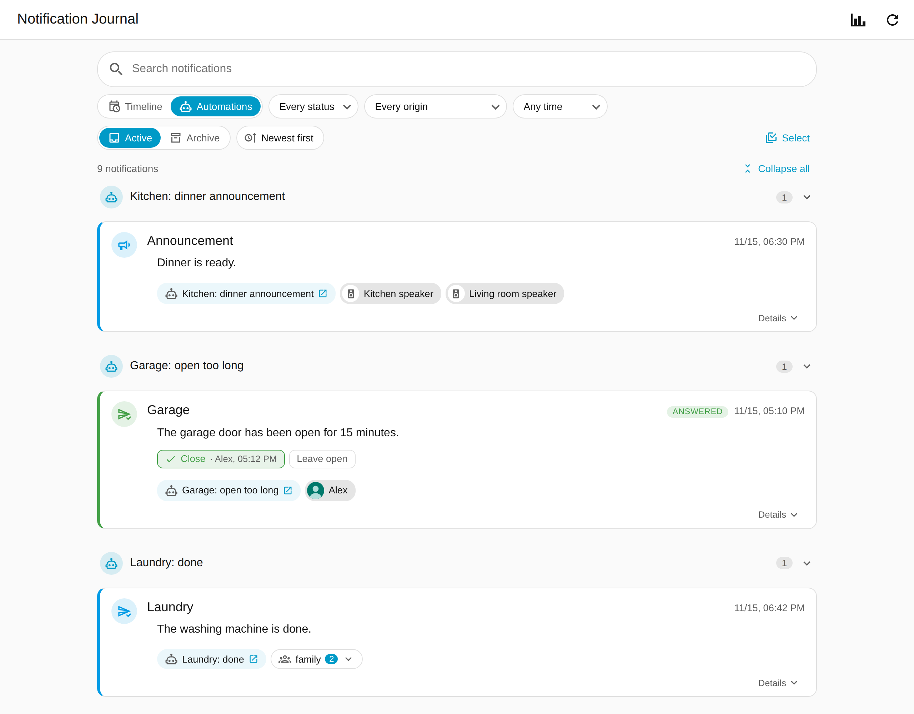
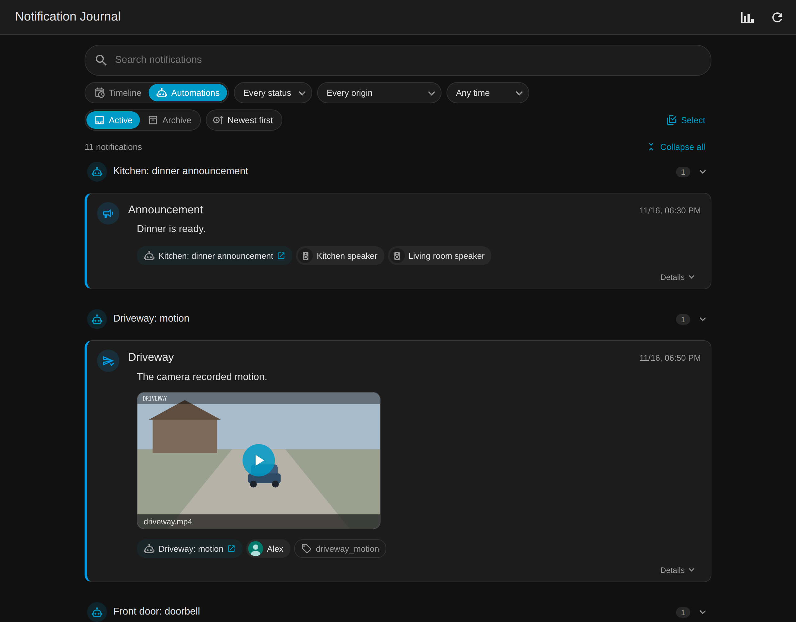
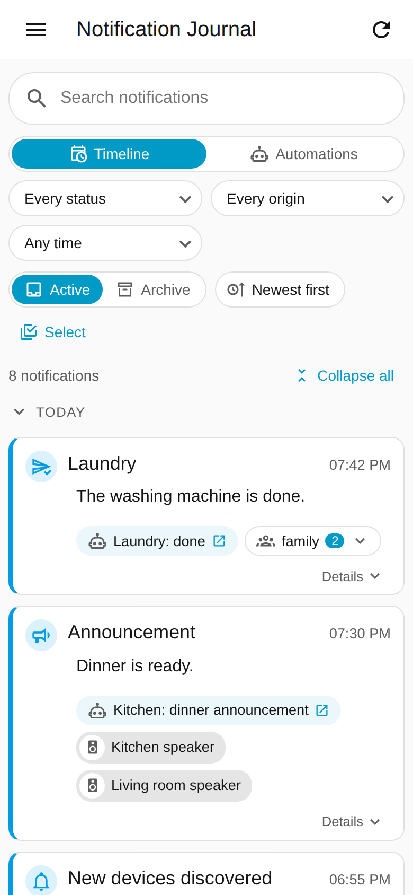
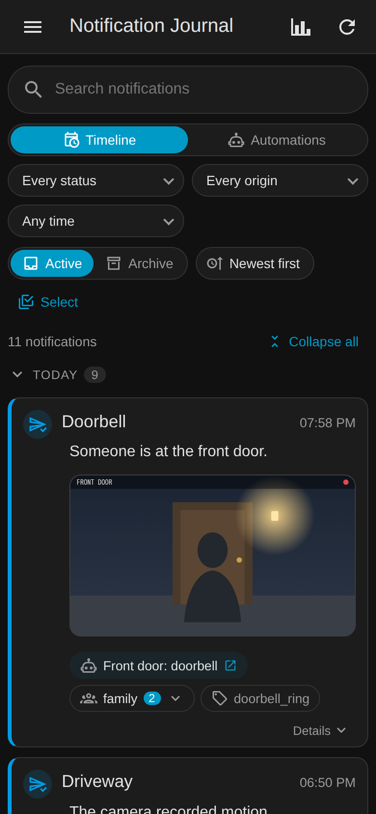

# Notification Journal

A Home Assistant integration that keeps a journal of every notification your home sends and shows it in a sidebar panel: what was sent, to whom, by which automation or script, and when.

Home Assistant forgets a notification the moment it is sent. Notification Journal records it as it goes out, without changing your automations, and keeps it searchable.

## Features

- **Records what your home sends**, without changing a single automation:
  - notify actions: the Companion app, notify groups, notify entities and every other notify integration
  - Home Assistant's own notifications under the bell in the sidebar (discovered devices, failed logins, `persistent_notification.create`), including when and by whom they were dismissed
  - spoken announcements with text: `tts.speak` on media players and `assist_satellite.announce` on voice satellites
  - Telegram: messages, captioned photos, videos and files, and polls sent with the Telegram bot's own actions, named after the chats
- **Shows the answers**: the buttons of an actionable notification in the Companion app, which one was tapped, by whom and when, and the text typed into a reply button. Everyone sees their own answers; administrators see all.
- **Shows who it reached**: notify groups are resolved into the people and devices behind them; a person's current name and picture are shown, and automations, scripts and integrations appear under their current name.
- **Shows where it came from**: the automation or script that sent it, with a link to the exact trace of that run, the user who sent it by hand, or the custom integration that sent it from its own code.
- **Two views**: a timeline by day, or grouped by automation; both sorted newest or oldest first, every day and group can be folded.
- **Search and filters**: full-text search over title, message, recipients and origin; filters for status, origin and period.
- **Archive**: select notifications and move them out of your view, as in Home Assistant's own lists; the archive is per person, others keep seeing them.
- **Private by person**: administrators see everything; everybody else sees the notifications sent to them, the bell and spoken announcements. Telegram chats belong to no Home Assistant user, so only administrators see those.
- **Live**: the panel updates while it is open.
- English and German.

## Installation

Notification Journal needs Home Assistant 2026.11 or newer and is installed from the Marketplace:

1. *Settings → Marketplace*, search for *Notification Journal*.
2. *Install*: the setup opens right away, no restart needed.

The panel *Notification Journal* appears in the sidebar. Only notifications sent from now on are recorded.

## Options

*Settings → Devices & services → Notification Journal → Configure*:

| Section | Option | Default |
|---------|--------|---------|
| Sources | Notifications (notify actions) | on |
| | Home Assistant's notifications (the bell) | on |
| | Speech announcements | on |
| | Telegram | on |
| | Do not record: channels whose notifications are skipped, from any source (a notify action or entity, a media player, a voice satellite) | none |
| Retention | Keep for | 90 days |
| | At most | 100,000 entries |
| Access | Users without administrator rights see: their own notifications and the bell, or nothing (the panel is then for administrators only) | their own |
| Sidebar | Show in the sidebar (hidden, the panel stays reachable under `/notification-journal`) | on |
| | Title, icon | *Notification Journal*, the bell on the stack |

A source turned off records nothing more; what is recorded stays. Changes apply when saved, without a restart.

## Status

Every card shows a status:

| Status | Meaning |
|--------|---------|
| Sent | Home Assistant sent the notification. The Companion app does not report delivery, so *sent* is as far as Home Assistant knows. |
| Open | A notification under the bell that is still there. |
| Dismissed | Removed from the bell, with the time and who did it. |
| Replaced | Home Assistant replaced it under the bell with a newer one of the same ID. |
| Answered | Someone tapped one of its buttons in the Companion app. |

## Privacy

Everything stays in your Home Assistant. The journal is an SQLite database, `notification_journal.db`, next to `configuration.yaml`, separate from the recorder. It holds per notification: title, message, the data sent with it (actions, references to images and links, tags), the recipients, the automation, script, user or integration that sent it, the answers to its buttons, and the time. Images and attachments themselves are not copied, only their references.

Old entries are deleted once a day (*Retention*). The database is part of every Home Assistant backup; recording pauses while a backup is taken. Removing the integration keeps the database file; delete it by hand if you want the journal gone.

## What it does not record

- Notifications sent outside Home Assistant, such as directly by an app or a cloud service.
- `media_player.play_media` with `announce`, `assist_satellite.start_conversation` and `ask_question`, and the older `tts.*_say` actions.
- Spoken announcements without text (a sound only).
- Telegram photos, videos and files without a caption, locations, stickers, media groups, and edits of messages already sent.
- Anything sent before the integration was set up.

## Screenshots

| Light | Dark |
|-------|------|
|  |  |
|  |  |
|  |  |

The screenshots show made-up data in Home Assistant's default theme.

## Similar projects

- [Notification History](https://github.com/Patafoin/ha-notification-history): a dashboard card for notify actions, with an import of the past from the recorder and buttons to run a notification's actions again.
- [Notify History](https://github.com/josa42/homeassistant-notify-history): a notify proxy that keeps what is sent through it.

## Contributing

Bug reports and ideas are welcome as [issues](https://github.com/kimpenhaus/ha-notification-journal/issues). How the integration is built, tested and released: [docs/DEVELOPMENT.md](docs/DEVELOPMENT.md).

## How this project was made

This project was written with substantial help from AI, under my direction: I decide what it does, review the changes and run it in my own home every day. If you would rather not use software made this way, I respect that, and this project is probably not for you.

## License

[MIT](LICENSE)
