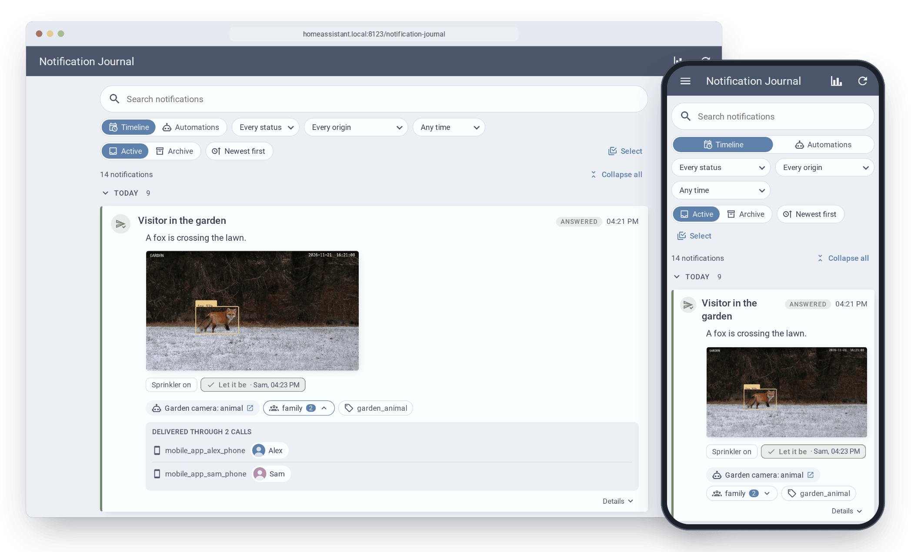
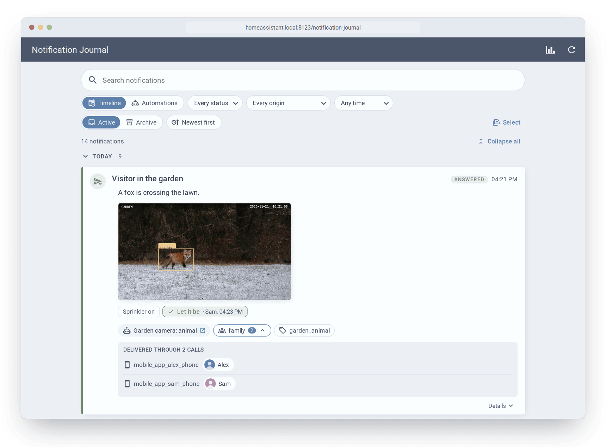
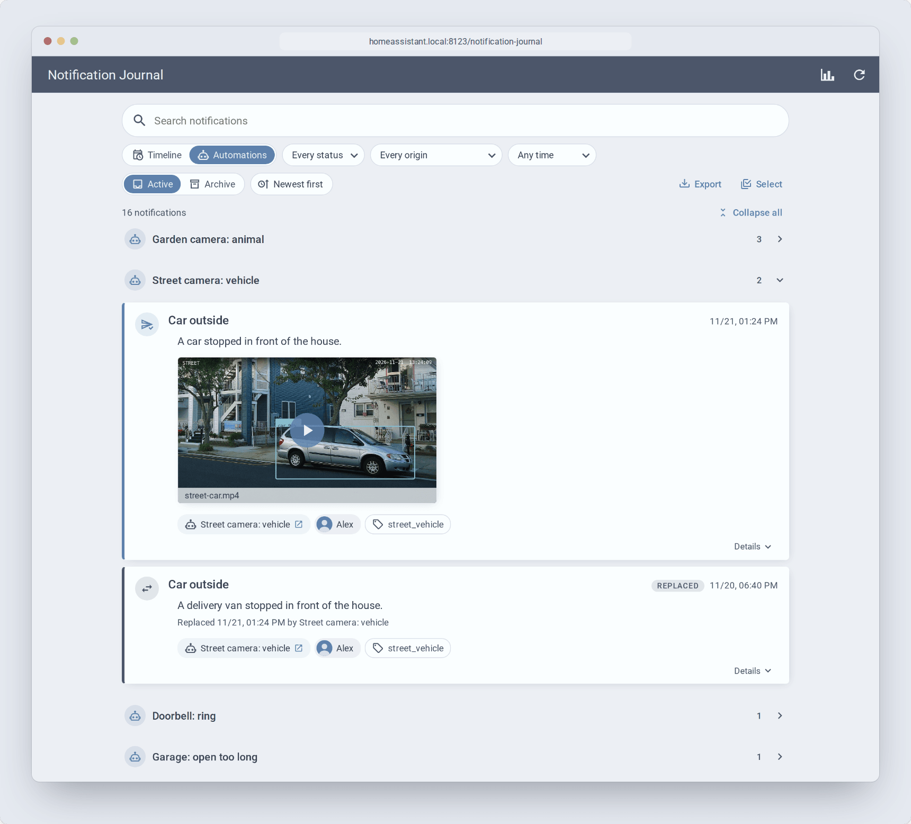
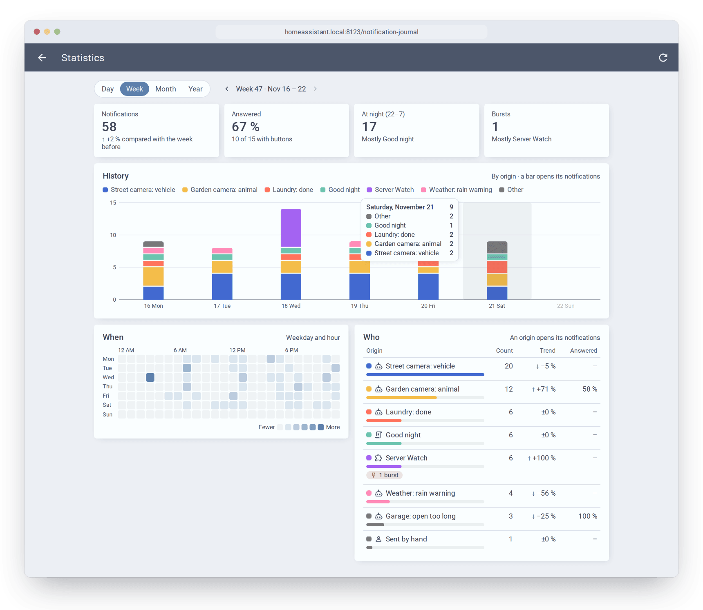

# Notification Journal

A Home Assistant integration that keeps a journal of every notification your home sends and shows it in a sidebar panel: what was sent, to whom, by which automation or script, and when.

Home Assistant forgets a notification the moment it is sent. Notification Journal records it as it goes out, without changing your automations, and keeps it searchable.

<picture>
  <source media="(prefers-color-scheme: dark)" srcset="docs/screenshots/hero-nordic-dark.png">
  
</picture>

## Features

- **Records what your home sends**, without changing a single automation:
  - notify actions: the Companion app, notify groups, notify entities and every other notify integration
  - Home Assistant's own notifications under the bell in the sidebar (discovered devices, failed logins, `persistent_notification.create`), including when and by whom they were dismissed
  - spoken announcements with text: `tts.speak` on media players and `assist_satellite.announce` on voice satellites
  - Telegram: messages, captioned photos, videos and files, and polls sent with the Telegram bot's own actions, named after the chats
- **Shows the answers**: the buttons of an actionable notification in the Companion app, which one was tapped, by whom and when, and the text typed into a reply button. Everyone sees their own answers; administrators see all.
- **Shows the media**: an image sent with a notification as a preview that opens in an overlay, a video with its image or first frame as a preview that plays in the card, audio as a link. Images that are gone fall back to a link.
- **Tags**: the Companion app's tag of a notification as a chip; a click shows all notifications with that tag.
- **Shows who it reached**: notify groups are resolved into the people and devices behind them; a person's current name and picture are shown, and automations, scripts and integrations appear under their current name.
- **Shows where it came from**: the automation or script that sent it, with a link to the exact trace of that run, the user who sent it by hand, or the custom integration that sent it from its own code.
- **Two views**: a timeline by day, or grouped by automation; both sorted newest or oldest first, every day and group can be folded. The timeline lists every day with its number of notifications and opens with only the newest one expanded; a day's notifications load when it opens. With a filter set, every day is expanded and the list loads page by page.
- **Statistics**: who notifies how much and when, by day, week, month or year: totals compared with the period before, the share of answered notifications with buttons, notifications at night, bursts (quarter hours with five or more from one origin) and failed notifications compared with the period before, a history by origin, a heatmap of weekday and hour, and a ranking of origins. A bar or an origin opens its notifications. The statistics outlast the retention of the notifications.
- **Search and filters**: full-text search over title, message, recipients and origin; filters for status, origin, period and tag.
- **Archive**: select notifications and move them out of your view, as in Home Assistant's own lists; the archive is per person, others keep seeing them.
- **Private by person**: administrators see everything; everybody else sees the notifications sent to them, the bell and spoken announcements. Telegram chats belong to no Home Assistant user, so only administrators see those.
- **Starts with the past**: on first setup it imports what Home Assistant's recorder still holds (10 days by default): notify calls, spoken announcements, Telegram messages and the answers to buttons. The automation or script that sent them comes from the recorded context; a notification an integration sent shows as unknown, and the bell's notifications from before are not in the recorder.
- **Live**: the panel updates while it is open.
- English and German.

## Installation

Notification Journal needs Home Assistant 2026.11 or newer and is installed from the Marketplace:

1. *Settings → Marketplace*, search for *Notification Journal*.
2. *Install*: the setup opens right away, no restart needed.

If you closed the setup, start it again under *Settings → Devices & services → Add integration → Notification Journal*:

The panel *Notification Journal* appears in the sidebar. It starts with what the recorder still holds and records everything sent from now on.

## Options

*Settings → Devices & services → Notification Journal → Configure*:

| Section | Option | Default |
|---------|--------|---------|
| Sources | Notifications (notify actions) | on |
| | Home Assistant's notifications (the bell) | on |
| | Speech announcements | on |
| | Telegram | on |
| | Do not record: channels whose notifications are skipped, from any source (a notify action or entity, a media player, a voice satellite) | none |
| Retention | Keep for | 90 days |
| | At most | 100,000 entries |
| | Keep statistics for: whole calendar years, at least two, never shorter than the notifications | 2 years |
| Access | Users without administrator rights see: their own notifications and the bell, or nothing (the panel is then for administrators only) | their own |
| Sidebar | Show in the sidebar (hidden, the panel stays reachable under `/notification-journal`) | on |
| | Title, icon | *Notification Journal*, the bell on the stack |

A source turned off records nothing more; what is recorded stays. Changes apply when saved, without a restart.

## Status

Every card shows a status:

| Status | Meaning |
|--------|---------|
| Sent | Home Assistant sent the notification. The Companion app does not report delivery, so *sent* is as far as Home Assistant knows. |
| Open | A notification under the bell that is still there. |
| Dismissed | Removed from the bell, with the time and who did it. |
| Replaced | Home Assistant replaced it under the bell with a newer one of the same ID. |
| Failed | Sending failed, with Home Assistant's error: an action that raised it inside an automation or script (as its trace shows), or what the Companion app logs when a push fails (push server unreachable, timeout, rate limit), as it does not raise an error then. An action called from the developer tools that raises leaves no trace to read. |
| Partly failed | A group whose members failed in part; the error is shown at each failed member. |

Administrators can send a failed or partly failed notification again with *Send again*: Home Assistant calls the same action with the same text and data, buttons and tag included, for a group only to the members that failed. It is recorded as a new notification by hand that says it repeats a failed one.
| Answered | Someone tapped one of its buttons in the Companion app. |

Failed pushes of the Companion app are read from what it logs at *warning* and above; with its log level set higher (`logger:` in `configuration.yaml`), they stay *sent*.

## Privacy

Everything stays in your Home Assistant. The journal is an SQLite database, `notification_journal.db`, next to `configuration.yaml`, separate from the recorder. It holds per notification: title, message, the data sent with it (actions, references to images and links, tags), the recipients, the automation, script, user or integration that sent it, the answers to its buttons, and the time. Images and attachments themselves are not copied, only their references; the panel loads a preview from that address in the browser of whoever looks at it. For the statistics it also counts per hour how many notifications each origin sent to whom, without any text.

Old entries are deleted once a day (*Retention*); the hourly counts stay as long as *Keep statistics for* says, also after the notifications are deleted. The database is part of every Home Assistant backup; recording pauses while a backup is taken. Removing the integration deletes the database with it; setting it up again starts a new journal.

## What it does not record

- Notifications sent outside Home Assistant, such as directly by an app or a cloud service.
- `media_player.play_media` with `announce`, `assist_satellite.start_conversation` and `ask_question`, and the older `tts.*_say` actions.
- Spoken announcements without text (a sound only).
- Telegram photos, videos and files without a caption, locations, stickers, media groups, and edits of messages already sent.
- Anything sent before the integration was set up, beyond what the recorder still held then; the bell's notifications from before setup.

## Screenshots

Made-up data in the [Nordic theme](https://github.com/coltondick/nordic-theme-main) (`nordic-blue`), light or dark as GitHub shows this page; the panel follows whichever theme you use.

### Timeline

Every day with its notifications; a notification shows its picture, the buttons and who tapped them, and whom a group reached.

<picture>
  <source media="(prefers-color-scheme: dark)" srcset="docs/screenshots/timeline-nordic-dark.png">
  
</picture>

### Grouped by automation

Each automation, script or integration with its notifications, folded or open.

<picture>
  <source media="(prefers-color-scheme: dark)" srcset="docs/screenshots/automations-nordic-dark.png">
  
</picture>

### Statistics

Who notifies how much and when, compared with the period before.

<picture>
  <source media="(prefers-color-scheme: dark)" srcset="docs/screenshots/statistics-nordic-dark.png">
  
</picture>

## Similar projects

- [Notification History](https://github.com/Patafoin/ha-notification-history): a dashboard card for notify actions, with an import of the past from the recorder and buttons to run a notification's actions again.
- [Notify History](https://github.com/josa42/homeassistant-notify-history): a notify proxy that keeps what is sent through it.

## Contributing

Bug reports and ideas are welcome as [issues](https://github.com/kimpenhaus/ha-notification-journal/issues). How the integration is built, tested and released: [docs/DEVELOPMENT.md](docs/DEVELOPMENT.md).

## How this project was made

This project was written with substantial help from AI, under my direction: I decide what it does, review the changes and run it in my own home every day. If you would rather not use software made this way, I respect that, and this project is probably not for you.

## License

[MIT](LICENSE)
